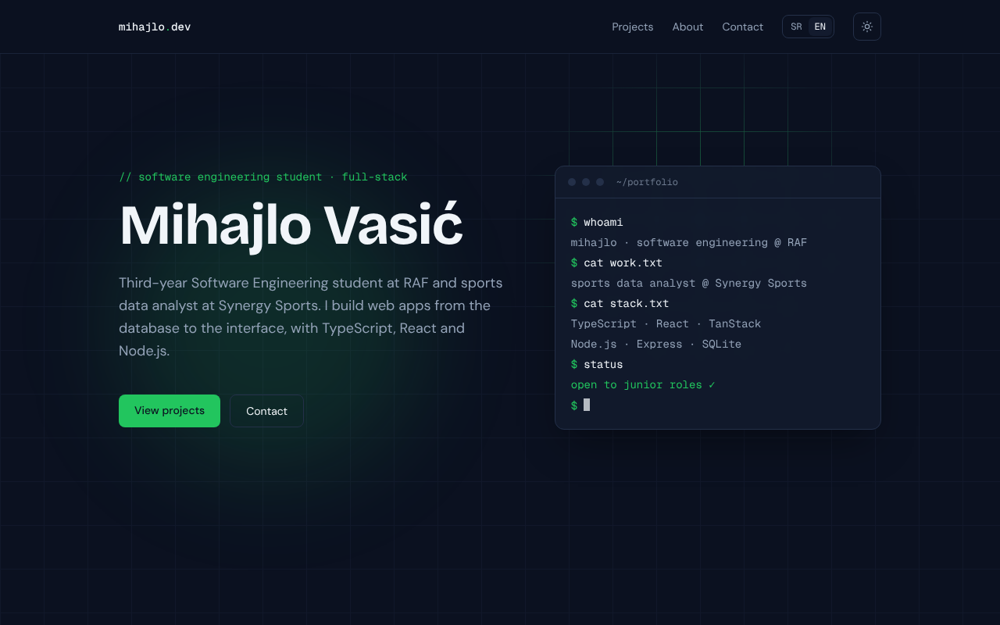
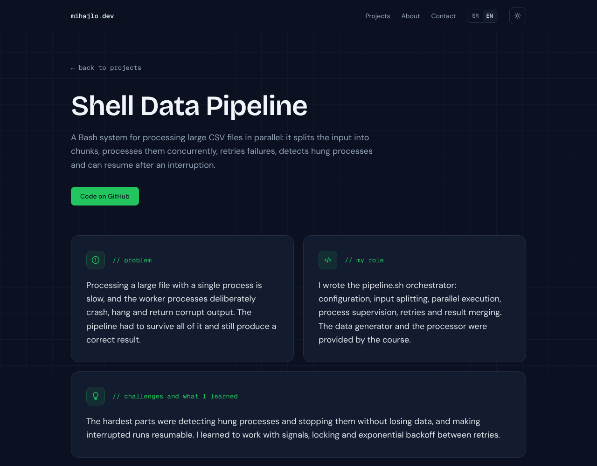
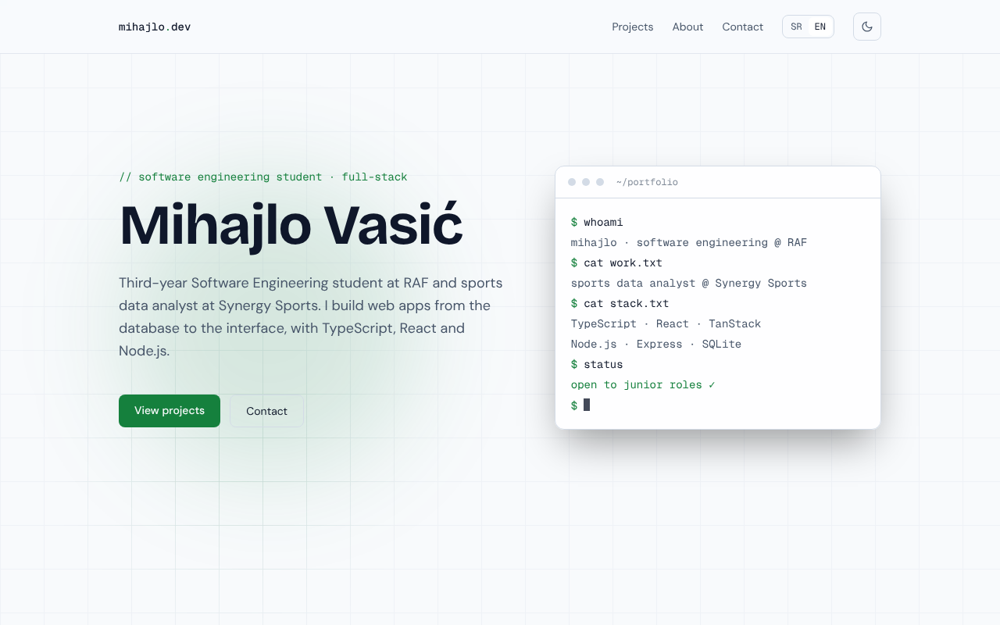
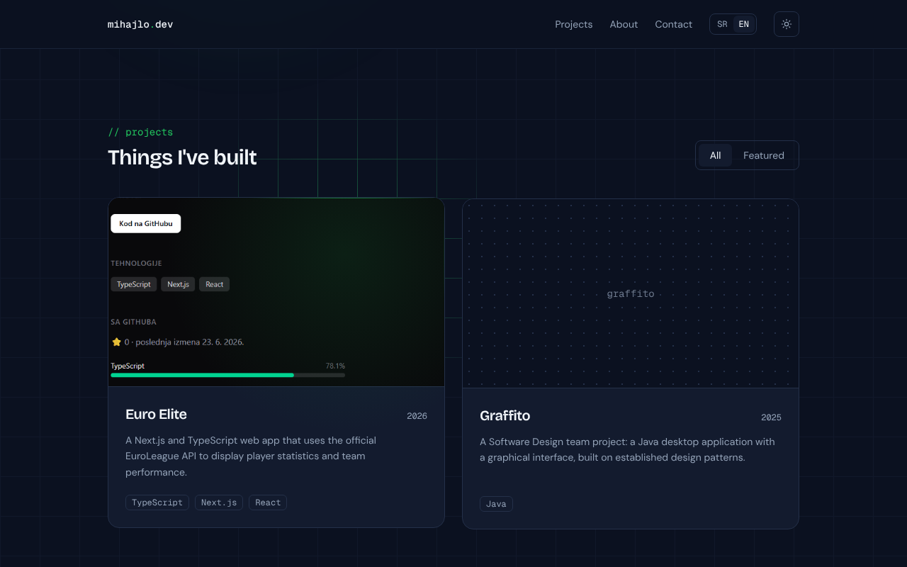
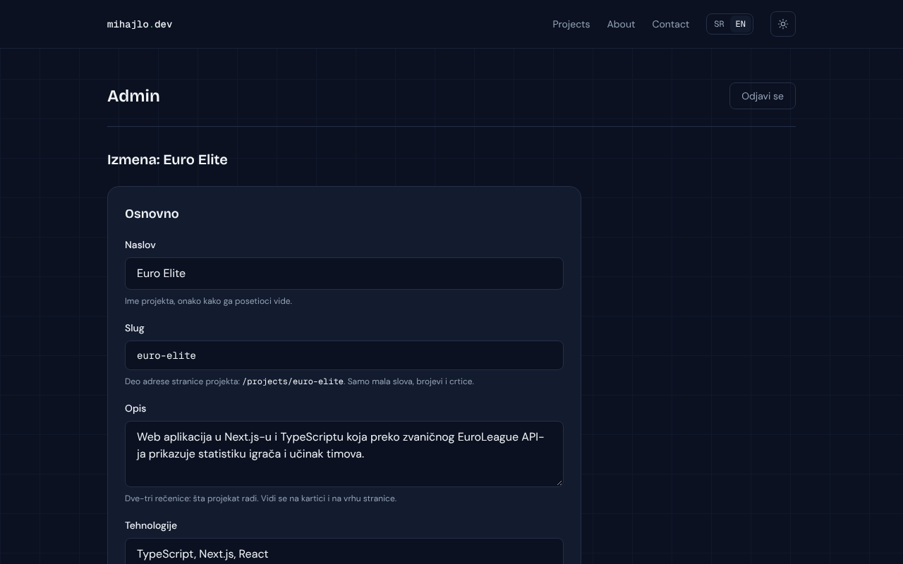

# Portfolio

My personal portfolio site: a full-stack TypeScript app with a public bilingual site and a private admin panel for managing projects.



## Features

**Public site**
- Projects loaded from the database, with a filter for featured ones
- A case study page for each project: the problem, my role, and what I learned
- Live GitHub data for each project: stars, last push, and language breakdown
- Serbian and English versions. The language is detected from the browser, kept in the URL (`?lang=en`) and switched with a cross-fade
- Light and dark theme, remembered between visits and applied before the first paint, so there is no flash
- Experience and education timeline, tech stack, and contact section
- Motion that respects `prefers-reduced-motion`

**Admin panel**
- Password login with a signed JWT in an `httpOnly` cookie
- Sortable, searchable project table (TanStack Table)
- Project form with validation (TanStack Form + Zod). The slug is generated from the title
- Import from my pinned GitHub repositories (GitHub GraphQL API)
- Image upload with drag and drop
- One-click Serbian → English translation of project texts through the Gemini API, which I review before saving

| Project page | Light theme |
|---|---|
|  |  |

| Projects | Admin |
|---|---|
|  |  |

## Tech stack

**Frontend** (`web/`)
- React 19, TypeScript, Vite
- TanStack Router (file-based routes, typed search params, route guards), TanStack Query, TanStack Form, TanStack Table
- Tailwind CSS v4 with theme tokens, Motion for animations, View Transitions API

**Backend** (`server/`)
- Node.js, Express 5, TypeScript
- Drizzle ORM with SQLite / libSQL (a local file in development, Turso in production)
- Zod validation on every input
- bcrypt password hashing, JWT sessions (jose)
- Multer uploads, with images stored in the database
- GitHub REST and GraphQL API, with a 10-minute in-memory cache
- Gemini API for translation

## Project structure

```
server/
  src/
    server.ts       Express app and routes
    auth.ts         login, sessions, requireAuth middleware
    github.ts       GitHub API client and cache
    translate.ts    Gemini translation
    db/schema.ts    Drizzle tables (projects, images)
  scripts/          one-off scripts (password hash, content, data migration)
web/
  src/
    routes/         TanStack Router file-based routes (public pages, login, admin)
    components/     UI components
    i18n.ts         translations and the useLang hook
    content.ts      timeline, tech stack and contact info
```

## Running locally

Requirements: Node.js 22+.

```bash
# Backend
cd server
npm install
cp .env.example .env        # then fill in the values (see below)
npm run hash-password -- "your-password"   # prints ADMIN_PASSWORD_HASH
npm run db:push             # creates the SQLite database
npm run db:seed             # optional: sample projects (replaces existing ones)
npm run dev                 # http://localhost:3000

# Frontend (in a second terminal)
cd web
npm install
npm run dev                 # http://localhost:5173
```

Vite proxies `/api` and `/uploads` to the backend, so the frontend and the API share one origin, just as in production.

### Environment variables (`server/.env`)

| Variable | Purpose |
|---|---|
| `ADMIN_PASSWORD_HASH` | bcrypt hash of the admin password |
| `JWT_SECRET` | secret for signing session tokens |
| `GITHUB_TOKEN` | GitHub token for repository data and pinned repos |
| `GEMINI_API_KEY` | optional, enables the translate button |
| `TURSO_DATABASE_URL`, `TURSO_AUTH_TOKEN` | production only. Without them the app uses `portfolio.db` |

## Deployment

The app is ready for Vercel and Turso. The backend runs as a single Vercel Function (Express), and the frontend is served from the CDN. `web/vercel.json` forwards `/api` and `/uploads` to the backend. The scripts `db:push:turso` and `db:copy-to-turso` create the production database and copy local content into it.

## Author

Mihajlo Vasić, Software Engineering student at RAF (Belgrade) and sports data analyst at Synergy Sports.
[GitHub](https://github.com/Vasic11) · [LinkedIn](https://www.linkedin.com/in/mihajlo-vasic-raf)
